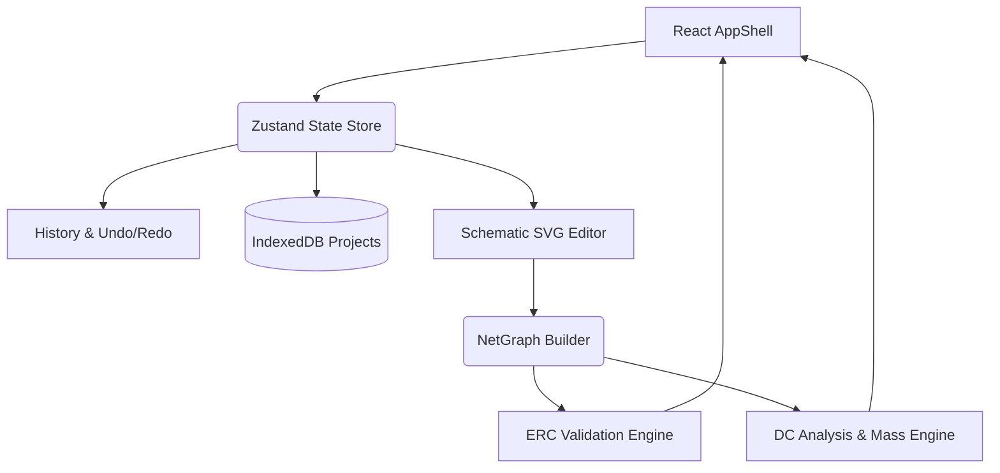

# CircuitSpace

**Rocket avionics CAD with 60+ components, 25+ electrical checks, live voltage/current/power/mass analysis & 8 design templates. Build, validate and export BOMs, netlists, reports & schematics in 6 formats.**

CircuitSpace is a domain-specific engineering tool tailored for safe, low-voltage rocket/aerospace avionics, sensing, telemetry, data logging, and electromechanical control. It specializes in system-level DC analysis and mass/power budgeting to provide rigorous validation of your designs.

 *(Note: Please build the project to view the interface.)*

## 🚀 Features

- **Dense but intuitive engineering workflow**: Modeled after professional CAD applications (e.g. KiCad) with robust interaction patterns like drag-to-move, box selection, undo/redo, and orthogonal wiring.
- **Meaningful calculations**: Real-time evaluation of mass, nominal/peak power, regulator utilization, voltage drops, and battery runtime.
- **Serious design validation**: 25+ real Electrical Rules Checks (ERC) covering everything from floating inputs and I2C address collisions to regulator overloads and power budget limits.
- **Project persistence**: Work in your browser with full local IndexedDB persistence, auto-saving, and portable `.cspace.json` files.
- **Large structured component library**: 60+ realistic aerospace and general electronics components ranging from IMUs and telemetry radios to LiPo batteries and buck/boost regulators.
- **Useful exports**: Generate 6 distinct export formats, including a robust PDF Design Report, CSV Bill of Materials (BOM), CSV Netlist, SVG/PNG schematics, and raw JSON.

## ⚡ Live Analysis Engine

CircuitSpace's non-SPICE DC analysis engine continuously computes:
- Regulated bus voltages and headroom limits
- Estimated nominal and peak current consumption
- Regulator thermal/current loading and efficiency losses
- Battery runtime estimation (with reserve percentage)
- Overall mass and system power totals against project budgets

## 🔍 Validation (Electrical Rules Check)

The comprehensive ERC system evaluates the component net graph in real-time. Checks include:
- Required pins left unconnected or dangling wires
- Ground/power pins lacking valid source paths
- Power-to-ground and direct-source short circuits
- Output-to-output contention and logic voltage mismatches
- Regulator input outside allowed range or insufficient headroom
- Connector and switch current limits exceeded
- Conflicting net labels and duplicate reference designators

## 🛠️ Editor Workflow

The workspace is a fully interactive SVG-based schematic editor:
- **Grid Snapping**: Components and wires align to an adjustable grid.
- **Orthogonal Wiring**: Professional L-shaped wire routing with dynamic junction dots.
- **Navigation**: Mouse-wheel zoom centered on cursor, space-drag panning, zoom-to-fit, and minimap.
- **Command Palette**: Press `Cmd/Ctrl + K` to access quick actions and settings.
- **Keyboard Shortcuts**: Native-feeling bindings for Select All, Delete, Undo (`Cmd+Z`), Redo (`Cmd+Shift+Z`), Duplicate (`Cmd+D`), and Save (`Cmd+S`).

## 📦 Setup & Development

CircuitSpace is built with **React**, **TypeScript**, and **Vite**, utilizing a centralized `Zustand` store for performance and state management.

```bash
# Install dependencies
npm install

# Run the development server
npm run dev

# Build for production
npm run build

# Run engineering logic tests
npm run test
```

## 🏗️ Architecture



## ⚠️ Limitations & Scope

**CircuitSpace is designed for safe avionics and telemetry.**
> Do **NOT** use this software to model or implement pyrotechnic igniters, deployment-charge firing circuits, explosive devices, propulsion control, or similar hazardous systems.

While CircuitSpace provides detailed power/mass budgeting and DC rule validation, it is **not** an analog SPICE simulator or a PCB layout tool. Always verify component datasheets and test physical circuits safely.

## 📝 License
MIT License
